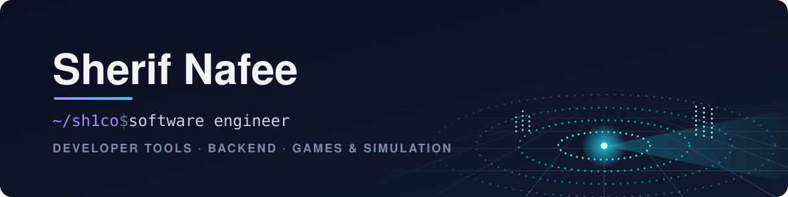

Hey, I'm **Sherif (Sh1co)**, a software engineer working across **developer tools & backend automation** and **games & simulation**.
I'm currently a Senior Engineer building autonomous-vehicle simulators with Unity, ROS2, and ZeroMQ.

## 🛠️ What I work on

<table>
<tr>
<th width="50%">Software & Tooling</th>
<th width="50%">Games & Simulation</th>
</tr>
<tr>
<td valign="top">

- Backend services and APIs with Python & FastAPI
- Automation and grading tooling for GitHub Classroom
- Docker, CI with GitHub Actions, testing with pytest
- Python ↔ C# inter-process messaging with ZeroMQ
- AI-assisted development workflows (Claude Code, MCPs)

</td>
<td valign="top">

- Robotics and vehicle simulators in Unity with ROS/ROS2 bridges
- Virtual LiDAR, RGB, and depth sensors (300%+ faster after a redesign)
- Large-scale simulation with Unity DOTS and flow-field pathfinding
- Games in Unity and Godot, including published mobile titles
- Game jams, including a win at the Innopolis University jam

</td>
</tr>
</table>

## ⚡ Tech Stack

**Languages** 

**Backend & Infrastructure** 

**Engines & Frameworks** 

## 📚 Background

- 🎓 MSc in Software Engineering (2025) and BSc in Computer Science (2023), Innopolis University
- 🏆 ICPC Qualifiers: First Degree (2020), Second Degree (2019) · IOI participant (2016)
- 👨‍🏫 Taught Operating Systems, Software Quality & Reliability, Software Architecture, and Game Development at Innopolis University

## 📫 Connect

Feel free to reach out about software, tooling, or games on [Telegram (@Sh1co)](https://t.me/Sh1co).

